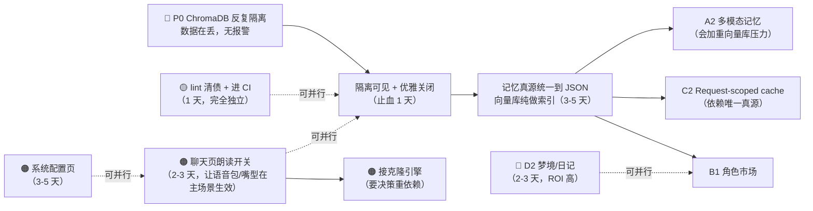

# 系统推进方案（优先级与依赖）

> 编写于 2026-09-18，基于 master `7f6df32` 的**实测**现状，不是照抄旧文档。
> 旧 `ROADMAP.md` 写于 2026-06-22，其中已完成项已归档，本文件是它的后续。

**本文件在同目录里的位置**：`plans/` 下的其他文档（`2026-07-17-clear-p0-tech-debt.md` 等）
都是**单件事的执行计划** —— 有 Goal / File Structure / 逐 Task 的 checkbox 步骤。
本文不同，它是**选哪些事做、按什么顺序做**的那一层，覆盖整个系统。
**选定其中一项后**，再按同目录的格式单独写一份执行计划（含基线、文件清单、逐步 checkbox）。

**状态标记**：🔴 P0 有真实数据风险 / 🟠 P1 已投入但没闭环 / 🟡 P2 工程债 / 🔵 P3 产品方向

---

## 0. 这份方案的依据

所有结论都来自实测，每条都带证据。几处与旧文档不一致的地方，以本文为准：

| 旧文档说法 | 实测结果 |
|---|---|
| 「前端 lint 债：`VRMAvatar.vue` 12 处、`CharactersView.vue` 1 处」 | **已过时**。当前 30 个 error，且集中在测试文件（`LipSyncEngine.test.ts` 12、`LipSyncEngine.spec.ts` 9），两个 `.vue` 都干净了 |
| 「ChromaDB 损坏备份清理 30m，P1」 | 不是一次性清理问题 —— **它今天 1.5 小时内又新增了 5 个**，是活跃的数据风险，见 §1 |
| 「P0 后台 tick 进行中」 | 已完成（`world_tick_scheduler.py` 在跑） |

---

## 1. 🔴 P0：ChromaDB 反复被隔离，RAG 记忆被静默清空

> **✅ 已修复（2026-10-12）** —— 见 `2026-10-12-fix-chroma-false-quarantine.md`。
> 根因与本节最初的推测**不同**，下方「实测更正」记录了真实结论。

**这是当前最该先处理的一件事**，因为它是**真实数据在丢**，而且**没有任何报警**。

### 证据

`backend/data/` 下实测有 **6 个 `chroma_corrupt_*` 隔离目录**，时间戳：

```
2026-07-10 17:36      （1 个，旧）
2026-09-18 16:10      ┐
2026-09-18 16:28      │
2026-09-18 16:40      ├ 5 个，全部集中在 1 小时 20 分钟内
2026-09-18 17:10      │
2026-09-18 17:29      ┘
```

每个目录里都有一个**真实大小的 `chroma.sqlite3`**（823KB → 1.3MB → 1.5MB → 1.6MB，
尺寸随当天递增 = 重建后又同步数据、再被扔掉）。合计约 **9.8MB 被隔离的向量库**。

### 影响

`memory_rag._quarantine_corrupt_dir()` 的日志自己写明了后果：

> long_memory/events/chat_summary 等**仅存向量库**的数据会丢失，
> profile/story/relationship 会在下次 /chat 时从 JSON 重新同步。

也就是：**长期记忆、事件、聊天摘要会被清空**，而用户端**看不到任何异常** ——
接口不报错、角色照常回复，只是"忘了"。

### 为什么一直没被发现

自愈逻辑设计得很好（隔离 + 重建 + 不抛 500），但它同时**把故障藏了起来**：
只有一行 `logger.warning`，没有堆栈、没有计数、没有上报。
「自愈成功」和「数据丢失」被合并成了同一种表现。

### ⚠️ 实测更正（2026-10-12）—— 它们根本没有损坏

动手修之前先做了两件事，结果**推翻了本节最初的"损坏"定性**：

1. 对 6 个隔离库跑 `PRAGMA integrity_check` → **全部返回 `ok`**；
2. 用 chromadb 直接打开它们 → **全部成功**，各含 12 个集合、15 条记录。

**这些库从来没有坏过。** 真因是：

```
FastEmbed 构造 embedding function 时访问 huggingface.co
  → 本机代理返回 502 / 代理不可达
  → 抛 httpx.ProxyError / httpx.ConnectError
  → 冒泡进隔离分支
  → 把健康的库整个 move 走（不可逆）
```

而隔离判定本身也不可靠：
- `_get_collection` 用 `"connect" in str(exc)` 判定"损坏" —— 这个子串本意是匹配 chroma 的
  `Could not connect to tenant`，但**也会命中 `httpx.ConnectError`**；
  而且它看的是**消息文本**：英文 locale 命中、中文 locale（"无法连接"）不命中，
  **同一份代码的行为随部署环境漂移**。
- `_get_client` 的 `except Exception` 会把任何异常都当成"初始化失败"→ 隔离。

所以真正的问题不是"库会坏"，而是**一个网络故障被当成磁盘损坏处理**。

### 已实施的动作

| # | 动作 | 状态 |
|---|---|---|
| 1 | 隔离前先做**健康探测**（能打开 + `integrity_check` 通过 → **拒绝隔离**） | ✅ |
| 2 | 异常分类改用**异常类型**（网络类显式排除），不再看消息文本 | ✅ |
| 3 | 隔离事件**可见**：traceback + 计数 + `/health` 的 `rag` 段 | ✅ |
| 4 | 启动时从**健康的隔离目录恢复**，而不是重建空库 | ✅ |
| 5 | lifespan shutdown 显式 `release_client()`（已端到端验证） | ✅ |
| 6 | 清理 9.8MB 残留目录 | ⏳ 留作证据，等恢复逻辑跑一段时间再删 |
| 7 | 根治：让「只存向量库」的数据变成可重建 | ⏳ 仍建议做，但优先级下降 —— 误隔离这个**实际在丢数据**的原因已堵住 |

> 原判断"第 4 条才是真正的解法"需要修正：在**误判**的前提下，让数据可重建是在给一个
> 不该发生的删除兜底。先修判定，再考虑重构存储形态。


---

## 2. 🟠 P1：把已经投入但没闭环的能力接完

这几项都是**成本已经付了大半**，差最后一截就能用。

### 2.1 语音包只接通了"半条链路" ✅ 已完成（2026-10-12）

> 见 `2026-10-12-chat-read-aloud.md`。

**原状**：TTS 只存在于语音通话（`conversation_manager.process_tts_queue`）。
用户在**聊天页打字，永远听不到角色的声音** —— 而这才是主场景。
刚做完的语音包（音色/语速/参考音频/每角色绑定）在文本聊天里**完全用不上**。

**已实现**：新增 `POST /chat/tts`（普通用户可用，按角色解析绑定的语音包）+
聊天页「朗读」开关（新回复自动播）+ 每条消息的朗读按钮。
播放复用既有 `playTtsBlob()` 通道，所以 **3D 嘴型同步就跟着活了**（实测 lip-sync 强度峰值 0.499）。

**顺带发现**：`setOnTtsPlayStateChange` 是单订阅且已被 `voiceCallStore` 占用，
而通话弹窗是浮在聊天页上的 —— 两者会互相顶掉。已加多订阅版 `subscribeTtsPlayState()`。

**⚠️ 未能 live 验证**：edge-tts 的合成端点当前上游 403（见 `2026-10-12-chat-read-aloud.md` 开头），
**语音通话的 TTS 同样受影响**。功能代码已就绪，上游恢复即可用。

### 2.2 音色克隆引擎没接

参考音频的上传、存储、参考文本、UI「引擎未部署」标记**全部就位**，
`engine: 'clone'` 的分支也已经存在（会明确报"未部署"而不是静默降级）。

**要决策的是重依赖**：XTTS-v2 / CosyVoice 需要 torch + GB 级权重，CPU 上每句约 1-3 秒。
接入本身只是新增一个 `_synth_clone()` 适配器 + 装依赖，**前端和存储一行都不用改**。

### 2.3 系统配置页其实不存在 ✅ 已完成（2026-10-12）

> 见 `2026-10-12-system-config-page.md`。

**原状**：`/admin` 只有**用户审批 + 配额**。所有 TTS / 嵌入 / 模型上限配置都是 `.env`，
改任何一项都要改文件 + 重启进程。

**已实现**：新增 `funcation/system_config.py`（schema 驱动）+ `GET/PATCH /admin/config`（仅管理员）+
`/admin` 的「系统配置」区（按 schema 动态渲染，12 个字段分 4 组）。
优先级**配置文件 > 环境变量 > 代码默认值** —— 不配任何东西时行为与改动前完全一致。

**过程中发现两个真问题**：
1. `voice_service.env_defaults()` **从来没被生产代码调用过**，而 `resolve_voice_config()`
   的 default 分支硬编码 `FALLBACK_VOICE` —— 也就是说 `tts.*` 配置**改了不会生效**（假功能）。
   已把 `env_defaults()` 作为 `global_default` 接进解析链。
2. **管理员刷新 `/#/admin` 会被弹回首页** —— 路由守卫是同步判断 `auth.isAdmin`，
   而用户信息是 `App.vue` 的 `onMounted` 里异步拉的，守卫跑在它之前。已改为 async 补一次 `fetchMe`。

**未做**：密钥类配置（JWT / 默认管理员密码 / API key）**刻意不暴露** —— 界面上改密钥有安全风险，
也会让现有会话失效。需重启的项只做到「存下来 + 重启后生效 + 界面如实标注」，不做热更新。

### 2.4 3D 的收尾 ✅ 部分完成（2026-10-12）

> 见 `2026-10-12-gltf-model-support.md`。

- **glTF AnimationClip 播放** ✅ **已修，且比原描述更严重**：
  后端 `EXTENSION_FORMAT_MAP` 允许上传 `.glb`/`.gltf`，但前端只有 VRM 分支、
  `if (!loadedVrm) throw` —— 也就是**后端接受的文件类型会让角色直接坏掉**。
  已拆成 VRM / 纯 glTF 两条分支，纯 glTF 通过 `AnimationMixer` 播放骨骼动画。
  实测：无报错 + 两帧像素差 2.78%（真的在动）+ **VRM 回归无变化**。
  遗留：播哪个 clip 固定取第一个，暂不开放选择。
- **模型文件 CDN 化** ⏳ **未做**：这是运维/部署决策（选供应商、改上传目标、处理回源），
  不是代码能单方面完成的。`model3d.url` 字段已支持外链，真要 CDN 化是在部署流程里配置。
  **如果你决定上 CDN，告诉我供应商，我把上传目标改过去。**

---

## 3. 🟡 P2：工程债（都有实测依据）

### 3.1 lint 没进 CI ✅ 已完成（2026-10-12）

> 见 `2026-10-12-frontend-lint-cleanup.md`。

`package.json` 里有 `lint:oxlint` / `lint:eslint`，但 `.github/workflows/ci.yml` **没有跑它们**。

**实测更正**：本节原来只统计了 oxlint（30 个）。实际上 `lint` 脚本跑**两个** linter：

| linter | 数量 |
|---|---|
| oxlint | **29 errors** |
| eslint | **67 errors + 15 warnings** |

而且原来写的「`LipSyncEngine` 两个测试文件内容重复」**不准确** —— 两者测的是不同侧面
（前者 MediaElementSource 创建/复用，后者 RMS 计算），只部分重叠。**本次不合并**（合并是无谓 churn）。

**已完成**：全部清零（oxlint 0；eslint 0 errors / 0 warnings），并接入 CI 作为阻断门。
新增 `lint:ci`（**不带 `--fix`**）—— 原 `lint` 带 `--fix`，会把问题就地改掉然后退出 0，**等于门是空的**。

**建议**：先清掉这 30 个（多数是 `vi.fn()` 缺类型参数这类机械修复），
顺手合并那两个重复的 LipSyncEngine 测试文件，**再把 lint 加成 CI 阻断门**。
工作量 **1 天**。

### 3.2 磁盘没有清理策略

`backend/data/` 实测：chroma 残留 9.8MB + `chroma_new` 184KB。
`data/` 被 .gitignore，所以没人会注意到它一直在长。

**建议**：随 §1-4 一起做 —— 一旦向量库变成可重建，就能安全地加一个"启动时清理 30 天前的隔离目录"。

### 3.3 首屏体积

`VRMAvatar` chunk **844KB**（three.js + three-vrm），是第二大 chunk（120KB）的 7 倍。
已经是懒加载，但用户一进聊天页就会拉。

**建议**：先不动（功能优先）。如果要做，方向是 three.js 按需引入 + 模型文件 CDN 化。

### 3.4 Request-scoped cache（旧文档 C2，一直没做）

一次 `/chat` 会把同一个记忆文件 `load → 改 → save` 8-10 次。
在 §1-4 把记忆真源统一到 JSON 之后做这件事会更安全（否则缓存和"唯一真源"两件事会互相干扰）。

---

## 4. 🔵 P3：产品方向（旧文档里仍未做的）

| 方向 | 内容 | 工作量 | 备注 |
|---|---|---|---|
| A2 多模态记忆 | 图片 → 视觉模型描述 → 入 RAG；语音备忘录 → STT | 1 周 | ROI 高，但会**加重 §1 的向量库压力**，建议排在 §1 之后 |
| B1 角色市场 | 发布 / 领养 / 评分 / 热度 | 2 周 | 从"自己玩"到"创作者经济"，需要审核流程 |
| B2 角色变体 | fork 角色 + LLM 改写人设 | 3-5 天 | 依赖 B1 的存储形态 |
| D2 梦境 / 日记 | 凌晨 LLM 睡前总结 → 次日主动说"我昨晚梦到…" | 2-3 天 | 复用 `chat_summary` + 主动消息，**ROI 很高** |
| D4 NPC 群聊旁观 | 让用户旁观 NPC 之间对话 | 1 周 | `interaction_agent` 已有关系数据 |
| D3 桌面挂件增强 | 系统托盘 / 开机自启 / 浏览器扩展 | 各 1-2 天 | MVP 已在跑 |
| C1 Postgres + pgvector | 用户表 + 记忆 JSONB + 向量库合一 | 1-2 周 | 等用户量上来。**顺带能解掉 §1 的并发写问题** |
| C3 计费 / C4 监控 | 套餐分级 / Sentry / 日志聚合 | 视用户量 | C4 里的"隔离事件上报"其实就是 §1-1 |

---

## 5. 建议的推进顺序



**如果只做一件事**：做 §1 的第 1、3、4 条。数据在丢而且没人知道，这比任何新功能都重要。

**如果要做一件"看起来有进展"的事**：§2.1 聊天页朗读开关 —— 它让语音包、3D 嘴型、
lip-sync 三块已完成的投入**同时在主场景生效**，用户能直接感知到。

---

## 6. 需要你拍板的三件事

1. **§1 的深度**：只做止血（1 天，隔离可见 + 优雅关闭），还是直接做根治（3-5 天，
   把记忆真源统一到 JSON）？我建议**先止血、尽快排根治** —— 止血只是让事故可见，
   不代表不再丢数据。
2. **克隆引擎要不要装**：这是**唯一一个需要重依赖**（torch + GB 级权重）的决定。
   不装的话语音包就停在"edge 固定音色"这一步（也能用，只是音色没法克隆）。
3. **系统配置页放哪**：现在语音包在 `/settings`（个人设置页）里，但它是**全局管理功能**，
   语义上更该在 `/admin`。要不要借这次机会把管理员功能统一挪到 `/admin`？

---

## 7. 已归档（旧 ROADMAP 的完成项，避免重复投入）

A1 后台 world tick ✅ / A3 多剧情 ✅ / A4 角色自我意识 ✅ / C5 CI + 测试 ✅ /
D1 3D 模型全链路 ✅ / D3 桌面挂件 MVP ✅

**本轮（2026-09-18）新增完成**：
3D 人物自然化 + 无框浮出 + 通话大立绘 + 程序化夜色背景 / 语音包（管理员全局库 + 每角色绑定）/
心情驱动表情 / 主题变量根因修复 / `current_event` 渲染修复 / 后端文件清理统一降级
